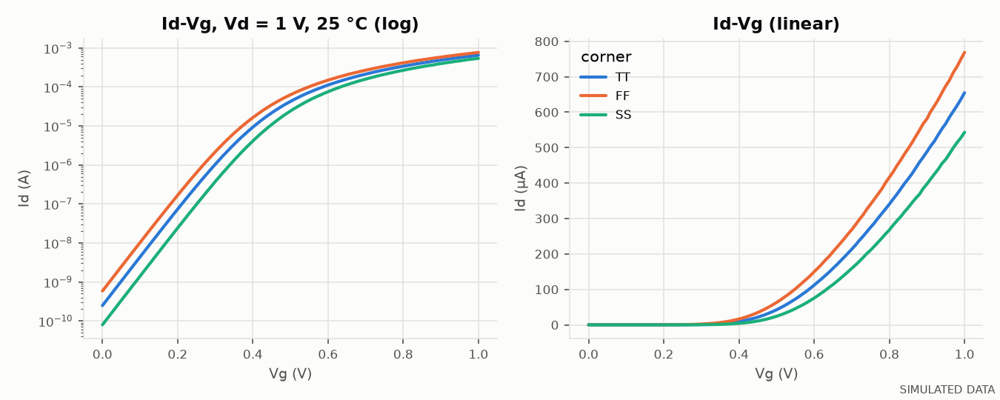
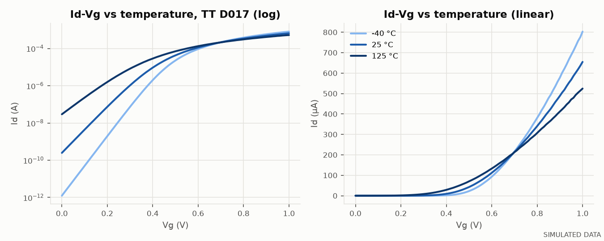
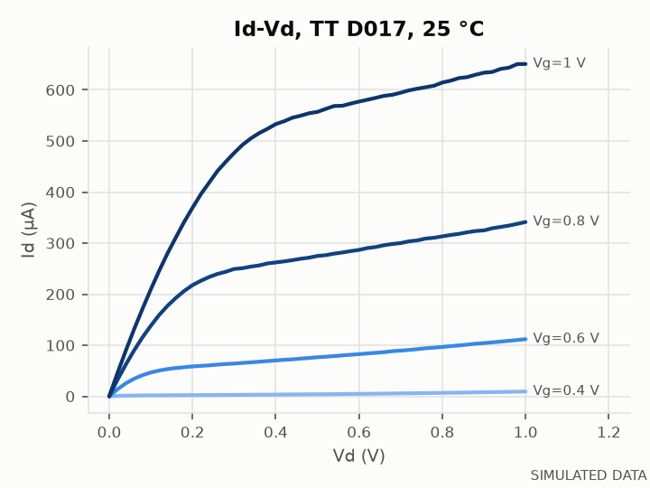
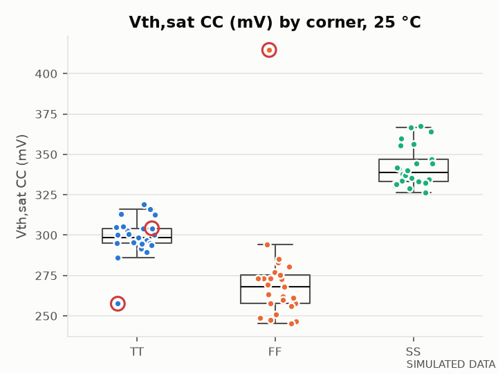
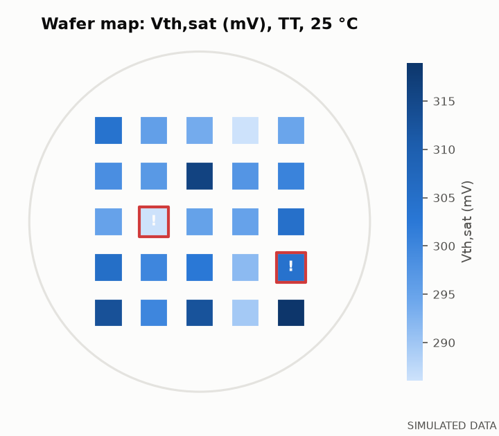
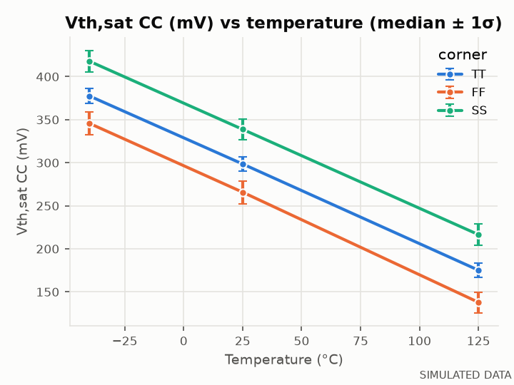
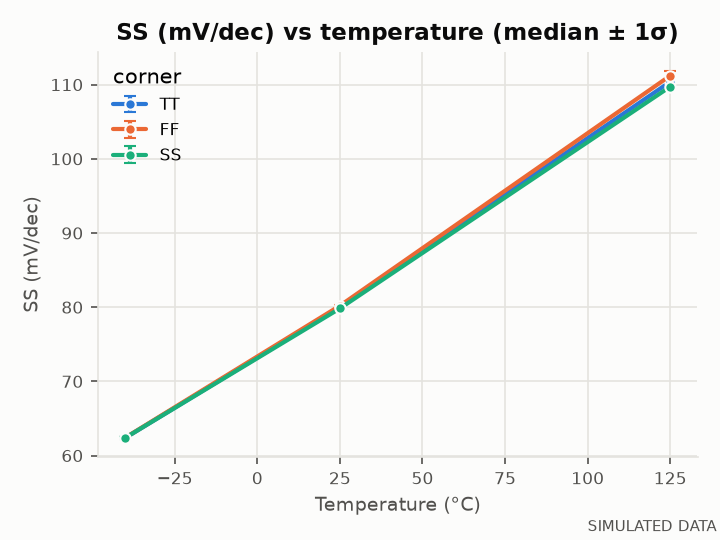

# ivchar: automated MOSFET/FinFET I-V characterization

`ivchar` is a Python tool for device characterization work. It drives a source-measure unit through
an instrument abstraction layer and runs standard Id–Vg / Id–Vd sweeps. It then extracts the usual
device parameters, runs batch statistics across dies, temperatures and process corners, flags
outliers and yield loss, and writes an HTML report. You can optionally add an AI-written anomaly
summary to the report.

> **All example data and figures in this repository are SIMULATED.** They come from the built-in
> compact-model backend, not from measured silicon. They show what the pipeline does, not results
> from a real device. Every report and figure produced from simulated data is labeled that way.



## Features

| Area | What it does |
|---|---|
| **Instrument abstraction** | One `SMU` interface with force-V/force-I, compliance-aware readings and staircase sweeps. Backends: Keysight **B1500A** (FLEX commands over PyVISA), a **generic SCPI SMU** (Keithley 2400-style), `MultiSMU` to combine several boxes, and a **simulated** 4-channel SMU. |
| **Simulated device** | EKV-style compact model, continuous from subthreshold to strong inversion. Includes DIBL, mobility degradation, CLM, temperature (kT/q, Vth(T), µ ∝ T⁻¹·⁵), gate and junction leakage, five process corners, die-to-die variation (random + radial), measurement noise floor and gain error, and optional injected defects. Planar and FinFET presets. |
| **Extraction** | Vth by constant current and by max-gm linear extrapolation, subthreshold swing, gm max (linear and saturation), Ion, Ioff, Ion/Ioff, DIBL and gate leakage. Points in compliance are excluded. |
| **Batch analysis** | pandas pipeline over dies × temperatures × corners: grouped statistics (leakage in log10), robust z-score (median/MAD) outlier flags, spec limits and yield per corner. |
| **Report** | matplotlib figures and a single self-contained HTML file: Id–Vg/Id–Vd, temperature behavior, distributions, Ion–Ioff, wafer map, yield and outlier tables. |
| **AI summary (optional)** | Sends aggregated statistics and the outlier table (never raw curves) to Claude and adds a short anomaly summary, clearly labeled as AI-generated. |
| **Quality** | 62 pytest tests: analytic known-answer tests for each extraction method, physics sanity checks, driver command strings against a fake VISA resource, and end-to-end CLI runs. |

## Quick start

```bash
git clone https://github.com/ymt1001816-cyber/ivchar.git
cd ivchar
python3.11 -m venv .venv && source .venv/bin/activate
pip install -e ".[dev]"

ivchar run --out output          # 25 dies x (-40, 25, 125 °C) x (TT, FF, SS), about 15 s
open output/report.html
pytest -q
```

Python 3.10 or newer is required.

### CLI

```bash
# Simulated batch: choose device, dies, temperatures, corners
ivchar run --device finfet --dies 40 --temps -40 25 85 125 --corners TT FF SS FS SF --out out_finfet

# One device: on the simulator, or on a real B1500A (needs: pip install "ivchar[visa]")
ivchar measure --backend sim --corner FF --temp 85 --out dev.csv
ivchar measure --backend b1500 --resource GPIB0::17::INSTR --w 1e-6 --l 1e-7 --vdd 1.0 --out dut.csv

# Analyze curves from elsewhere (measured, SPICE or TCAD) with the same pipeline
ivchar analyze dut.csv --w 1e-6 --l 1e-7 --vdd 1.0 --spec planar --no-simulated --out dut_report

# Add the AI anomaly summary (needs: pip install "ivchar[llm]" and ANTHROPIC_API_KEY)
ivchar run --llm
```

`analyze` reads a long-format CSV with columns `sweep` (`idvg`/`idvd`), `vg`, `vd`, `id`. The
optional columns are `ig`, `compliance`, `corner`, `die`, `temp_c`, `x`, `y`.

### Python API

```python
from ivchar.device import make_device
from ivchar.instruments import SimulatedSMU   # or B1500A("GPIB0::17::INSTR")
from ivchar.measure import standard_sweeps
from ivchar.extraction import extract

dev = make_device("planar", corner="TT", temp_c=25)
with SimulatedSMU(dev) as smu:
    curves = standard_sweeps(smu, vdd=1.0)
print(extract(curves, w=1e-6, l=100e-9, vdd=1.0))
```

## Architecture

```
src/ivchar/
├── instruments/
│   ├── base.py        SMU abstract class, Reading (value + compliance flag), staircase sweep
│   ├── simulated.py   SimulatedSMU: compact model + noise + compliance
│   └── visa.py        B1500A, GenericSCPISMU, MultiSMU (PyVISA)
├── device.py          compact model, presets, process corners
├── measure.py         id_vg, id_vd, standard_sweeps -> long-format DataFrame
├── extraction/        Vth (CC, max-gm), SS, gm, Ion/Ioff, DIBL
├── analysis/          batch runner, statistics, outliers, spec/yield
├── report/            figures, HTML report, optional LLM summary
└── cli.py             ivchar run | measure | analyze
```

Measurement and analysis code depends only on the `SMU` interface, so the same sweep routines run
unchanged on the simulator, a B1500A, or several single-channel SMUs combined with `MultiSMU`.
Each reading carries its compliance status. Points taken in compliance are the instrument's limit,
not the device's response, and are never used as device data.

## Extraction methods

| Parameter | Method | Physics |
|---|---|---|
| **Vth (CC)** | Vg at Id = 100 nA·W/L, log-interpolated | Simple and robust to series resistance. Works at any Vd, so it is used for DIBL. |
| **Vth (max-gm LE)** | Tangent at peak gm in the linear region, extrapolated to Id = 0, minus Vd/2 | In the linear region Id ≈ k(Vg − Vth − Vd/2)·Vd. |
| **SS** | Minimum dVg/dlog₁₀Id over a 5-point sliding fit, between the noise floor and the CC current | Diffusion current gives Id ∝ exp(Vg / n·kT/q), so SS = n·(kT/q)·ln10 ≈ n × 60 mV/dec at 300 K. |
| **gm max** | Peak of a windowed least-squares derivative | The window suppresses noise amplification from differentiating measured data. |
| **Ion / Ioff** | Id at Vg = Vdd and Vg = 0, both at Vd = Vdd | |
| **DIBL** | (Vth,lin − Vth,sat) / (Vd,sat − Vd,lin), in mV/V | A high drain bias lowers the source barrier in short channels. |

Each method is tested against analytic curves with known answers. The full pipeline is also tested
against the compact model: extracted SS matches n·kT/q·ln10 within 3%, and an injected 50 mV Vth
shift is recovered within 2 mV.

## Example results (simulated)

These come from the default run: `ivchar run`, planar NMOS, 25 dies × 3 temperatures × 3 corners,
seed 0.

| | |
|---|---|
|  |  |
|  |  |
|  |  |

What the figures show:

- **Temperature.** Ioff rises by about four decades from −40 °C to 125 °C, and SS grows roughly in
  proportion to T. Ion falls because mobility degrades. The curves cross near the
  zero-temperature-coefficient point around Vg ≈ 0.7 V.
- **Corners** shift Vth by about ±35 mV. SS barely changes between corners, because SS is set by n
  and T, not by Vth.
- **Outlier detection.** The simulator injected two defects: a gate-leakage die (TT D016) and a
  +150 mV Vth excursion (FF D014). Both are flagged, and both fail the 25 °C spec. Four other dies
  are flagged without an injected defect. One is a −3.8σ Vth draw from the random variation
  (TT D002), and three are marginal (|z| ≈ 3.6–3.8) gm or gate-current flags near the noise floor.
  The report lists the injected ground truth next to the flags so detection can be checked.

## Hardware notes

The B1500A and generic SCPI drivers are tested against expected command strings with a fake VISA
resource. **They have not yet been validated on a physical instrument.** Check the integration
time, ranging and compliance settings against your instrument's programming guide before measuring
real devices.

## License

MIT
